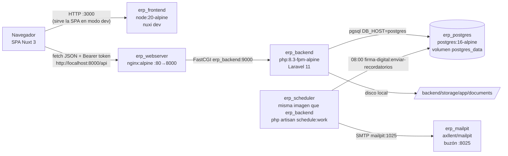
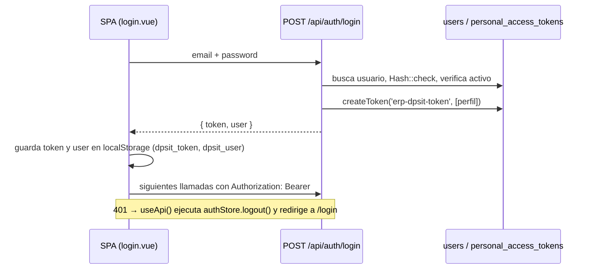
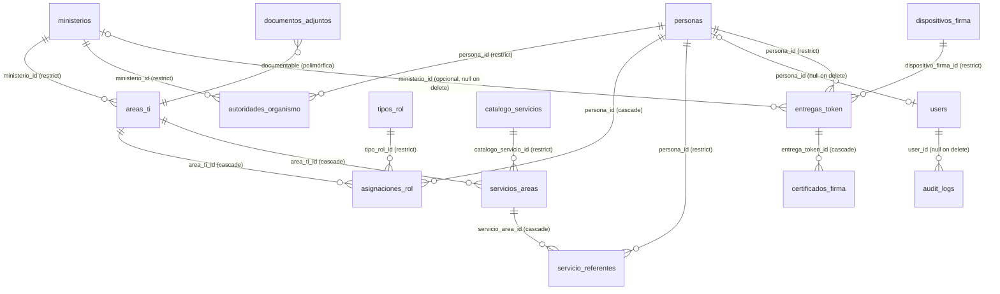

# Arquitectura

Reconstruida a partir del código el 2026-10-23. Las afirmaciones marcadas *(inferencia)* no se
verificaron en ejecución.

## Componentes

| Componente | Responsabilidad | Ubicación |
| :--- | :--- | :--- |
| SPA | UI, estado de sesión (Pinia + `localStorage`), llamadas a la API | `frontend/` |
| Nginx | Proxy FastCGI hacia PHP-FPM, `client_max_body_size 50M` | `docker/nginx/default.conf` |
| Laravel API | Rutas, autenticación por token, autorización por perfil, validación, persistencia, auditoría, exportación | `backend/` |
| PostgreSQL | Persistencia relacional (usa `ILIKE` y `jsonb`, por lo tanto **acoplado a PostgreSQL**) | volumen `postgres_data` |
| Almacenamiento | Archivos adjuntos en disco `local` (`storage/app/documents/<tipo>/`), no públicos | `backend/storage/` |

Módulo de expedientes: la lógica del circuito vive en `App\Services\ExpedienteService` (cada acción
actualiza la intervención e inserta su movimiento en la misma transacción). La importación de la planilla
es el comando `expedientes:importar`. La autorización por módulo la aplica el middleware
`CheckModuloAcceso` (alias `modulo`).

Hay **una** tarea programada: `firma-digital:enviar-recordatorios`, diaria a `FIRMA_RECORDATORIO_HORA`
(`routes/console.php`). La ejecuta el contenedor `erp_scheduler` con `schedule:work`. El correo sale
sincrónico (sin colas) por SMTP; en desarrollo lo captura **Mailpit** y no se reenvía (D-22). No hay
colas, jobs, eventos ni otras integraciones externas. El frontend carga la fuente *Plus Jakarta Sans*
desde Google Fonts.

## Backend (Laravel 11)

- Arranque: `backend/bootstrap/app.php` registra rutas `web`, `api`, `console`, health check `/up`, el
  alias de middleware `perfil` → `App\Http\Middleware\CheckPerfilAcceso` y `HandleCors` en el grupo `api`.
  El manejo de excepciones es el predeterminado (sin personalizar).
- Capas: **controladores** (`app/Http/Controllers/Api/*`) con validación inline y lógica de negocio;
  **servicios** solo para auditoría y exportación; **modelos** Eloquent con relaciones y *scopes*.
  No hay Form Requests, Policies, API Resources, repositorios ni eventos.
- `AppServiceProvider` define un `morphMap` (`user`, `area_ti`, `servicio_area`, `asignacion_rol`,
  `persona`) usado por documentos adjuntos y por los tokens de Sanctum. Si se agrega un modelo
  polimórfico hay que registrarlo ahí (si no, error `No morph map defined`, visto en el log del 2026-08-19).
- Configuración institucional: `config/app.php` → `agency.*` desde `AGENCY_*`.
- Sesión y caché con driver `file`; `config/session.php` y `config/cache.php` fueron creados a mano.

### Autenticación y autorización

- Guard `auth:sanctum` con tokens personales; `expiration: null` (los tokens **no expiran**).
- Autorización por perfil en `routes/api.php`:
  - lectura: cualquier usuario autenticado;
  - alta y modificación: `perfil:ADMINISTRADOR,EDITOR`;
  - borrado y tipos de rol: `perfil:ADMINISTRADOR`.
  `CheckPerfilAcceso` deja pasar siempre al ADMINISTRADOR y rechaza a usuarios inactivos.
- Las *abilities* del token (`[perfil]`) no se consultan en ningún lugar.
- En el frontend, el control es cosmético (`v-if`). La redirección a `/login` ocurre en
  `layouts/default.vue` (`onMounted`); no hay middleware de rutas.
- **Excepción:** `GET /api/documentos/{id}/descargar` y `GET /api/export/download` están fuera de
  `auth:sanctum` (ver `docs/security.md` SEC-01).

### Persistencia y transacciones

- Transacciones explícitas en `AreaTiController::designarAutoridad` (cierra la autoridad previa y
  crea la nueva), `ServicioAreaController::store` (instancia + referentes) y en las escrituras de firma
  digital (alta de entrega con dispositivo y certificado, reemplazo, finalización, renovación).
- Vigencia de certificados: una sola definición en `CertificadoFirma` (accesor `estado_certificado` y
  `scopeEstadoCertificado`); «certificado actual» = mayor `fecha_inicio`, luego mayor `id`
  (`EntregaToken::certificadoActual` y `CertificadoFirma::scopeActuales`).
- Auditoría: `AuditService::log()` en cada escritura, login, logout, descarga de adjuntos y descarga
  CSV (la vista previa del exportador no se audita) →
  tabla `audit_logs` (valores anteriores y nuevos en `jsonb`). No hay endpoint para consultarla.
- Las **vigencias** se calculan por fecha:
  - `AsignacionRol::scopeVigente()`: `activo` y `fecha_inicio <= hoy` y (`fecha_fin` nula o `>= hoy`);
  - accesor `estado_vigencia`: `VIGENTE`/`HISTORICO`/`FUTURO`/`INACTIVO`.
  Las relaciones `asignacionesVigentes` y `maximaAutoridadVigente` (en `AreaTi` y `Persona`)
  **no** verifican `fecha_inicio` (ver defecto DEF-04 en `docs/agents/current-state.md`).

### Modelo de datos

| Tabla | Claves y restricciones relevantes | Soft delete |
| :--- | :--- | :--- |
| `ministerios` | `codigo` único, `orden_prioridad` | sí |
| `autoridades_organismo` | máxima autoridad del organismo (D-32): ministerio + persona, `cargo` libre, `fecha_inicio` nula = desconocida, `fecha_fin` nula = vigente. `AutoridadOrganismoService::designar` cierra toda autoridad abierta o con cese futuro (no reproduce DEF-09) | sí |
| `areas_ti` | `codigo` único, `es_homologada`, `nivel_jerarquico` (texto libre, default `DIRECCION_PROVINCIAL`) | sí |
| `personas` | `cuil_cuit` (13) y `email_principal` únicos y **opcionales** desde D-19; `tipo_documento` + `numero_documento` opcionales, únicos en par | sí |
| `tipos_rol` | `codigo` único, `nivel_responsabilidad` ∈ EJECUTIVO/TACTICO/OPERATIVO, `es_maxima_autoridad_default` | no |
| `asignaciones_rol` | persona + área + rol, `fecha_inicio`, `fecha_fin` nula = sin fin, `es_maxima_autoridad`, `acto_administrativo` | sí |
| `catalogo_servicios` | `codigo` único, `categoria` (texto libre; valores previstos en el comentario de la migración: INFRAESTRUCTURA, IDENTIDAD, INTEGRACION, SEGURIDAD, SOFTWARE; el seed usa los cuatro primeros) | no |
| `servicios_areas` | `codigo_instancia` único, `estado_servicio` ∈ SOLICITADO/EN_PROCESO/ACTIVO/SUSPENDIDO/DADO_DE_BAJA | sí |
| `servicio_referentes` | único (`servicio_area_id`, `persona_id`, `tipo_referente`); tipo ∈ TECNICO_PRINCIPAL/TECNICO_ALTERNO/ADMINISTRATIVO/SEGURIDAD | no |
| `documentos_adjuntos` | polimórfica (`documentable_type` ∈ morphMap), `sha256`, `archivo_path` privado | sí |
| `users` | `perfil_acceso` ∈ ADMINISTRADOR/EDITOR/LECTOR, `activo`, `persona_id` opcional | no |
| `dispositivos_firma` | token físico: `tipo_dispositivo`, `marca`, `modelo`, `numero_serie` (único si existe), `estado` ∈ DISPONIBLE/ASIGNADO/DEVUELTO/EXTRAVIADO/DADO_DE_BAJA | sí |
| `entregas_token` | persona + dispositivo; organismo **opcional**: `ministerio_id` **o** `organismo_externo` (D-20); `cargo_funcion`; `fecha_entrega`, `fecha_fin`; `estado` ∈ ASIGNADA/DEVUELTA/REEMPLAZADA/EXTRAVIADA/REVOCADA. Índice parcial único: un dispositivo con a lo sumo una entrega ASIGNADA | sí |
| `user_modulos` | rol de un usuario por módulo (único por usuario y módulo). EXPEDIENTES: CONSULTA < OPERADOR < SUPERVISOR (D-26) | no |
| `expedientes` | `numero` normalizado (único), `numero_busqueda` (solo letras y dígitos), `formato` GDE/OTRO, `anio`, `reparticion`, `ministerio_id` (organismo, D-28), `caratula` | sí |
| `expediente_intervenciones` | un pase por el área: `numero_intervencion`, `fecha_ingreso`, `fecha_egreso` (puede faltar en datos importados), **`en_area`** (lo mantiene el servicio), estado, requerimiento, responsable, revisor, fechas de revisión y firma, destino, `documento_respuesta` (GEDO), prioridad, próxima acción, vencimiento opcional, `origen` SISTEMA/PLANILLA. Índice parcial único: una intervención abierta por expediente | sí |
| `expediente_intervencion_colaboradores` | intervención ↔ usuario | no |
| `expediente_movimientos` | historial **solo inserción** (el modelo lanza excepción al modificar o borrar): tipo, fecha, estado anterior/nuevo, autor, descripción, documento, próximo paso, `importado` | no |
| `expediente_estados`, `expediente_tipos_requerimiento`, `dependencias_destino` | catálogos configurables (se desactivan, no se borran). Estados: `es_final`, `requiere_documento`, `exime_documento` | no |
| `certificados_firma` | N por entrega (renovaciones, D-21): `fecha_inicio` (≠ entrega si corresponde), `fecha_vencimiento`, `fecha_recordatorio`, flags `*_manual`, `recordatorio_estado` ∈ PENDIENTE/ENVIANDO/ENVIADO/ERROR/SIN_EMAIL/CANCELADO, `recordatorio_enviado_at`, `recordatorio_email`, `recordatorio_intentos`, `recordatorio_ultimo_error` | no |
| `audit_logs` | `accion`, `modulo`, `registro_id`, `valores_*` jsonb, solo `created_at` | no |
| `personal_access_tokens`, `password_reset_tokens` | estándar de Sanctum/Laravel (el reseteo de contraseña no se usa) | — |

Los enumerados se validan en los controladores; en la base son `string` sin `CHECK`. Las FK con
`cascadeOnDelete` no se disparan en la práctica porque los modelos usan soft delete. Las 12 migraciones
iniciales (`2026_01_01_*`) se editaron directamente (D-08); el módulo de firma digital agregó 4
migraciones **nuevas** (`2026_10_23_*`), incluida una que modifica `personas`.

## Frontend (Nuxt 3)

- `nuxt.config.ts`:
  - `ssr: false` (SPA pura), `typescript.strict`, módulos `@nuxtjs/tailwindcss` y `@pinia/nuxt`;
  - `runtimeConfig.public`: `apiBase` y `agency*`, con sanitizador de comillas.
- Estructura:
  - `pages/`: un archivo grande por módulo, de 300 a 1.340 líneas, con formularios, modales y llamadas
    a la API en el mismo componente;
  - `components/`: `ToastContainer`, `ConfirmModal`, `PersonaSearchSelect`;
  - `composables/`: `useApi`, `useToast`, `useAgency`;
  - `plugins/`: `dialogo.ts`, directiva `v-dialogo` para los paneles de los modales (`role="dialog"`,
    título asociado, foco inicial y atrapado, Esc con pila de modales, retorno del foco al cerrar);
  - `stores/`: `auth`, `notification`.
- `useApi()` arma la URL con `apiBase`, agrega `Authorization: Bearer`, limpia parámetros vacíos
  (`cleanParams`) y hace logout ante un 401. Excepción: la subida de archivos en `areas-ti/[id].vue`
  usa `$fetch` directo con `FormData`.
- Errores: `useToast().toast.error(err)` traduce los mensajes de validación de Laravel (en inglés o en
  español) a textos legibles (`formatBackendError`).
- Descargas: enlace `<a href>` y `window.open` sin token (por eso esas rutas quedaron públicas).

## Infraestructura local

Hay **dos definiciones paralelas del stack** que deben mantenerse sincronizadas a mano:

| Aspecto | `wslc-setup.ps1` (Windows, en uso) | `docker-compose.yml` (Linux) |
| :--- | :--- | :--- |
| Nombres | `erp_postgres`, `erp_backend`, `erp_webserver`, `erp_frontend` | servicios `postgres`, `backend`, `webserver`, `frontend`; contenedores `erp_dpsit_*` |
| Resolución de la BD | alias `postgres` (D-18, confirmado el 2026-10-23) | nombre de servicio `postgres` |
| Host FastCGI en nginx | `erp_backend` existe ✔ | `erp_backend` **no existe** en Compose *(inferencia: la API fallaría en Linux)* |
| Variables | `--env-file .env` | bloque `environment:` con valores por defecto |
| Base de datos | `migrate` + seed solo si la base está vacía; `-Reset` recrea (con confirmación) | `setup.sh` igual (`--reset` recrea); `make fresh` recrea |
| Correo y tareas | `erp_mailpit` (alias `mailpit`) y `erp_scheduler` | servicios `mailpit` y `scheduler` |

`wslc-setup.sh` es una tercera variante (Bash + WSLC) desactualizada respecto del `.ps1`: no define
alias de red y fija `DB_HOST=erp_postgres`. Ver `docs/development.md`.

## Decisiones arquitectónicas identificables

Ver `docs/decisions.md`.
