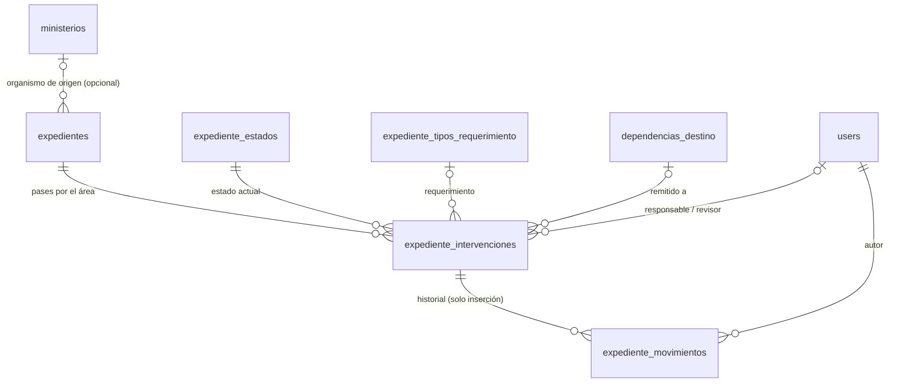
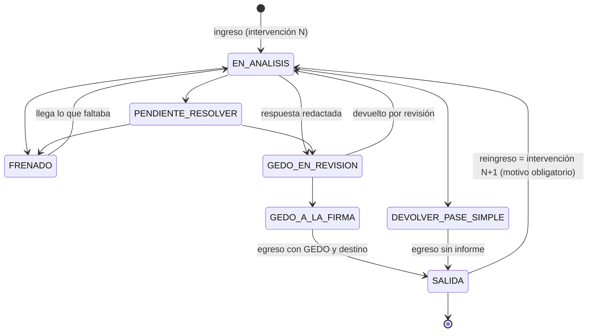

# Propuesta: módulo de seguimiento de expedientes administrativos

Estado: **en implementación** (2026-10-23). Respuestas del responsable: P1 = permisos por módulo (D-26), P2 = pantalla de usuarios (D-27), P3 = unificar organismos (D-28), P4 = migrar solo 2026 (D-29). P5–P13: criterios conservadores (D-31) hasta confirmar. Reemplaza la planilla
«MOVIMIENTOS DE EXPEDIENTES.xlsx» que usa el área. Etapas 1 (relevamiento) y 2 (propuesta) del pedido.
**No** incluye datos personales: los nombres del equipo y de los agentes que aparecen en la planilla no se
transcriben aquí.

## 1. Relevamiento de la planilla

Análisis automatizado de solo lectura de las 10 hojas: estructura, validaciones, fórmulas, formato
condicional y perfil estadístico de los datos.

### 1.1 Hojas y finalidad

| Hoja | Filas con datos | Finalidad aparente | Evidencia |
| :--- | ---: | :--- | :--- |
| 2026 MOVIMIENTO DE EXPEDIENTES | 1.082 | Registro principal del año en curso | Encabezado en fila 9; tablero en filas 1–7 |
| 2025 MOVIMIENTO DE EXPEDIENTES | 1.206 | Registro del año anterior; incluye 11 ingresos de 2023–2024 arrastrados | Misma estructura que 2026 |
| 2024 MOVIMIENTO DE EXPEDIENTES | 613 | Registro 2024, estructura anterior | Columnas con otros nombres, sin «Estado» como lista |
| Analisis de agentes | 740 | **Copia de trabajo** de 2025: 667 filas idénticas | Mismo EE + ingreso + egreso |
| Ioma | 21 | Seguimiento paralelo de 10 EE de IOMA, ya presentes en 2026 | Columnas extra «Revisado por» / «Observación» |
| EX PERSONAL PARA ANÁLISIS | 30 | Casos de personal (bonificaciones) que requieren unificar criterios; 27 están en 2026 | Estados propios: Resuelto / Frenado / A la espera de respuesta. Tabla «Temas a resolver» (3 temas, sin respuesta ni definición) |
| ORGANISMOS 2025 | 52 | Catálogo de organismos de origen + conteo por organismo | Lista desplegable de la columna Organismo |
| BIENES 2025 | 38 | Catálogo de tipos de requerimiento (bienes/servicios) | Lista desplegable de la columna Requerimiento |
| Estados | 7 | Catálogo de estados | Lista desplegable + tablero |
| Hoja personal de un integrante | — | Tablero individual: cantidad por estado, pendientes, «en análisis», **expedientes por prioridad según días en el organismo** | Calculado a mano o con fórmulas propias |

### 1.2 Unidad de registro: la fila es una **intervención**, no un expediente

Cada fila representa **un pase del expediente por el área**, desde que ingresa hasta que egresa. Un mismo
expediente vuelve varias veces:

- 2026: 1.082 filas, **842 expedientes distintos**; 185 tienen más de una fila (hasta 5).
- 2025: 1.206 filas, 907 expedientes; 219 repetidos (hasta 6).
- La descripción lo dice explícitamente: «2da intervención» (440 menciones en las tres hojas anuales), «3ra», «4ta».
- En el 93 % de los pares consecutivos de un mismo EE, el egreso de una fila es anterior o igual al ingreso
  de la siguiente: son pases sucesivos, no duplicados.

**Consecuencia para el diseño:** separar el **expediente** (identidad) de sus **intervenciones**
(cada pase) y del **historial de movimientos** dentro de cada intervención. Reproducir la planilla como
una tabla única duplicaría los datos del expediente en cada pase.

### 1.3 Columnas (hojas 2025–2026) y uso real

| Columna | Tipo | Completitud 2026 | Observaciones |
| :--- | :--- | ---: | :--- |
| Ingreso | fecha | 100 % | 2 textos mal tipeados (años «0206») |
| Egreso | fecha | 89 % | Sin egreso = sigue en el área. 3 egresos anteriores al ingreso; fechas futuras (hasta 2029) por error de tipeo |
| Nº Expediente Electrónico | texto | 99,9 % | Formato GDE `EX-AAAA-NNNNNNNN- -GDEBA-REPARTICION` en el 99,5 %; resto con formato `5900-NNN/AAAA` (otro sistema de numeración); espacios iniciales |
| Organismo | lista (52) | 100 % | 47 usados en 2026 |
| Descripción | texto | 100 % | Carátula/asunto; contiene «Nª intervención» y, en casos de personal, apellidos |
| EE analizado por | lista (8 nombres) | 98 % | **Responsable**. A veces dos personas («A, B»). Variantes mal escritas en 2024 |
| Requerimiento | lista (≈ 38) | 97 % | «Nomenclador Informático» = 65 % (casos de personal); el resto, bienes y servicios TI, homologación de áreas TI, proyectos normativos, oficios judiciales |
| Estado | lista (7) | 98 % | Ver 1.4 |
| ETB | texto | 0–6 % (20 % en 2024) | Valores «Sí/No» y «CM Renglón N». **Significado no confirmado** |
| A revisión | fecha | 79 % | Fecha de envío a revisión |
| Envíado a | lista (2 nombres) | 79 % | **Revisor/supervisor** que revisa antes de la firma; variantes mal escritas |
| Firma | fecha | 2 % (64 % en 2024) | Fecha de firma; prácticamente en desuso desde 2025 |
| Remitido a | texto libre | 88 % | **Dependencia de destino** al egresar. 257 variantes en 2026 (≈ 192 tras normalizar espacios y puntuación) |
| Observaciones | texto | 90 % | En el **≈ 85–90 % contiene solo el número del GEDO de respuesta** (`IF-…-GDEBA-DPSITMGGP`; también `PV-` y `NO-`) |
| C/ acto administrativo | lista (Sí / No corresponde / Pendiente) | 0,4 % | Casi sin uso. **Significado a confirmar** |

### 1.4 Estados actuales (hoja «Estados») y uso en 2026

| Estado | Filas 2026 | Interpretación propuesta (a validar) |
| :--- | ---: | :--- |
| EE EN ANÁLISIS | 12 | Un integrante está analizando el expediente |
| EE PENDIENTE DE SER RESUELTO | 7 | Analizado, falta definir/resolver |
| FRENADO | 6 | Detenido: espera información, criterio o respuesta externa |
| GEDO EN REVISIÓN | 52 | Respuesta redactada, en revisión del supervisor |
| GEDO A LA FIRMA | 1 | Respuesta revisada, pendiente de firma |
| PARA DEVOLVER CON PASE SIMPLE | 0 | Se devuelve sin informe (solo pase). ¿Es una forma de salida? |
| SALIDA de EE | 985 | Egresó del área (finalizado para esa intervención) |

Además: 19 filas sin estado y 18 con «SALIDA» pero sin fecha de egreso.

### 1.5 Automatizaciones existentes

- **Tablero** (filas 1–7): `COUNTIF` por estado, total de EE registrados y «Total de EE en DPSIT» (los que
  no están en SALIDA).
- **Listas desplegables** para organismo, responsable, requerimiento, estado, revisor y acto administrativo.
- **Formato condicional** que resalta un número de EE ya registrado (`COUNTIF > 1`): detecta reingresos.
- Paneles congelados y autofiltros.
- Conteo de expedientes por organismo en la hoja de organismos (con rangos desactualizados).

### 1.6 Problemas detectados

1. **Duplicación de hojas:** las copias («Analisis de agentes», «Ioma», «EX PERSONAL») divergen del
   registro principal.
2. **Texto libre donde debería haber catálogo:** destinos (257 variantes), responsables y revisores con
   errores de tipeo.
3. **Fechas inválidas:** años de 3 dígitos, egresos antes del ingreso, fechas futuras.
4. **Estado y egreso incoherentes:** «SALIDA» sin egreso; filas sin estado.
5. **Una columna con dos funciones:** Observaciones guarda el número de GEDO de respuesta.
6. **Sin historial dentro del pase:** solo hay fecha de ingreso, revisión, firma y egreso. Los cambios
   intermedios (p. ej., de «en análisis» a «frenado») se sobrescriben y se pierden.
7. **Sin plazos:** no hay fecha de vencimiento ni de próxima acción. La prioridad se calcula a mano por
   **días en el área**. En 2026, la mediana es de 6 días, el percentil 90 de 28 y el máximo de más de un año.
8. **Dos personas en un mismo campo** de responsable.

### 1.7 Necesidades operativas que se desprenden

- Ver qué hay **en el área ahora** (sin egreso), por estado y por responsable.
- Detectar **reingresos** de un mismo expediente y ver sus intervenciones anteriores.
- Controlar el **circuito de revisión y firma** (quién revisa y desde cuándo).
- Ordenar por **antigüedad en el área** (prioridad).
- Registrar la **respuesta** (número de GEDO) y el **destino** de cada salida.
- Separar los **casos que esperan criterio** («Temas a resolver»).
- Contar por organismo, requerimiento y estado (tablero).

## 2. Qué ofrece el ERP para reutilizar

| Necesidad | En el ERP | Uso propuesto |
| :--- | :--- | :--- |
| Usuarios y autenticación | `users` + Sanctum | Responsables, revisores y autores de movimientos = usuarios del ERP. **No hay pantalla de gestión de usuarios** (ver pregunta P2) |
| Permisos | Perfil **global** ADMINISTRADOR / EDITOR / LECTOR (`perfil:`) | Insuficiente por sí solo: un EDITOR de otro módulo podría editar expedientes. Ver P1 |
| Organismos | `ministerios` (6 de demo) | Reutilizar como catálogo de organismos e importar los 52 de la planilla. Ver P3 |
| Auditoría | `AuditService` / `audit_logs` | Toda escritura del módulo |
| Tareas programadas y correo | `erp_scheduler` + Mailpit/SMTP (módulo de firma digital) | Avisos opcionales (sección 6) |
| Documentos | `documentos_adjuntos` (archivos propios) | **No se usa** para respuestas: los documentos viven en GDE; se registra su número |
| UI | `useApi`, `useToast`, `confirmDialog`, patrón de página con indicadores, filtros y tabla; componentes en subcarpeta | Igual que el módulo de firma digital |
| Personas | `personas` (padrón) | **No se usa**: el equipo son usuarios y los agentes mencionados en la carátula no se modelan (dato personal sin necesidad operativa) |

## 3. Modelo de datos propuesto

| Tabla | Contenido | Notas |
| :--- | :--- | :--- |
| `expedientes` | `numero` (normalizado, único), `formato` (GDE / OTRO), `anio`, `reparticion` (sufijo GDE), `ministerio_id` opcional, `caratula` | Identidad del expediente; se crea una sola vez |
| `expediente_intervenciones` | `expediente_id`, `numero_intervencion` (1, 2, 3…), `fecha_ingreso`, `fecha_egreso`, `estado_id`, `tipo_requerimiento_id`, `responsable_id`, `revisor_id`, `fecha_envio_revision`, `fecha_firma`, `dependencia_destino_id`, `documento_respuesta` (p. ej. `IF-2026-…`), `prioridad`, `proxima_accion` + `fecha_proxima_accion`, `fecha_vencimiento` (opcional), campos a confirmar (`etb`, `con_acto_administrativo`), `observaciones` | **Una fila de la planilla = una intervención.** Solo una puede estar abierta por expediente |
| `expediente_intervencion_colaboradores` | intervención ↔ usuario | Cubre «A, B» en responsable sin perder al segundo |
| `expediente_movimientos` | `intervencion_id`, `fecha`, `tipo` (INGRESO, ASIGNACION, CAMBIO_ESTADO, ENVIO_REVISION, FIRMA, EGRESO, REAPERTURA, NOTA), `estado_anterior_id`, `estado_nuevo_id`, `user_id`, `descripcion`, `referencia_documento`, `fecha_proximo_paso` | **Solo inserción**: sin edición ni borrado desde la API. Lo genera el sistema en cada acción, más notas manuales |
| `expediente_estados` | `nombre`, `orden`, `color`, `es_final`, `requiere_revisor`, `activo` | **Configurable** (ADMIN); se precargan los 7 actuales |
| `expediente_tipos_requerimiento` | `nombre`, `grupo` (Personal / Bienes y servicios / Normativa / Otros), `activo` | Precargado con «BIENES 2025» y los valores usados |
| `dependencias_destino` | `nombre`, `organismo` (opcional), `activo` | Normaliza «Remitido a»; autocompletar con alta en el momento |

**Estado actual del expediente** = estado de su intervención más reciente. Está «en el área» si esa
intervención no tiene egreso.

## 4. Ciclo de vida (propuesta a validar)

- **Transiciones:** para no imponer un circuito que no está validado, la primera versión **permite
  cualquier cambio** entre estados no finales y registra cada uno en el historial. Las restricciones del
  diagrama se activan solo si el área lo confirma (pregunta P6).
- **Finalizar** = registrar **egreso**. Pasa a un estado `es_final` y exige fecha de egreso y destino. El
  documento de respuesta es obligatorio salvo en «Devolver con pase simple».
- **Reingreso:** el expediente egresado vuelve con una **nueva intervención**, con motivo y conservando
  todo lo anterior. Es lo que hoy se anota como «2da intervención».
- **Reapertura por error:** solo ADMINISTRADOR o supervisor puede reabrir una intervención egresada. Queda
  un movimiento REAPERTURA con motivo.
- **Fechas de cada cambio:** cada movimiento guarda fecha y autor. Las fechas de ingreso, egreso, revisión y
  firma se editan solo con motivo, que queda registrado (sección 7).

## 5. Pantallas y consultas

1. **Tablero del área:**
   - indicadores: en el área, por estado, sin responsable, en revisión, frenados, con próxima acción
     vencida, egresos del mes;
   - «mis expedientes»;
   - lista de **prioridad por días en el área**, que reemplaza la hoja personal;
   - últimos movimientos.
2. **Listado con filtros:**
   - número de EE (busca también sin espacios ni guiones), organismo, responsable (incluye «sin
     responsable»), estado, requerimiento;
   - rangos de ingreso, egreso y vencimiento;
   - «solo en el área», «con próxima acción vencida» y antigüedad (más de N días);
   - paginación con tope y exportación a CSV.
3. **Ficha del expediente:**
   - carátula y organismo;
   - todas sus intervenciones, en línea de tiempo;
   - historial de movimientos de cada una;
   - acciones: asignar, cambiar estado, enviar a revisión, registrar firma, egresar, agregar nota, reingresar.
4. **Alta de ingreso:**
   - con el número de EE el sistema **detecta si ya existe** (reemplaza el formato condicional) y propone
     abrir la intervención N+1 con los datos del expediente ya cargados.
5. **Catálogos** (solo ADMINISTRADOR): estados, tipos de requerimiento y dependencias de destino.
6. **Importación de la planilla** (solo ADMINISTRADOR o comando): ver sección 8.

## 6. Plazos y alertas

La planilla **no registra plazos**: no se asume ningún vencimiento a partir de la fecha de ingreso.

- `fecha_vencimiento` es **opcional**, por intervención, para los casos en que exista un plazo real.
- `fecha_proxima_accion` es opcional; puede venir de una nota («volver a consultar el …»).
- **Antigüedad en el área:** se calcula y muestra siempre; el umbral de alerta es configurable.
- **Avisos por correo** (opcional, pregunta P5): un resumen diario por responsable con próximas acciones
  vencidas y expedientes que superan el umbral. Se reutiliza el scheduler y el correo del módulo de firma
  digital.

## 7. Permisos y controles

| Acción | Propuesta |
| :--- | :--- |
| Consultar | Integrantes del área y quienes el ADMINISTRADOR habilite |
| Registrar ingreso, cambiar estado, agregar nota, enviar a revisión | Integrantes del área |
| Asignar o reasignar responsable | Supervisor / ADMINISTRADOR (a validar) |
| Registrar firma y egreso | Integrantes del área |
| Reabrir una intervención egresada; corregir fechas de ingreso o egreso | Supervisor / ADMINISTRADOR, con motivo obligatorio |
| Editar catálogos e importar | ADMINISTRADOR |
| Borrar | No se borran expedientes ni movimientos: anulación lógica con motivo (ADMINISTRADOR) |

Cualquier integrante puede registrar movimientos en un expediente asignado a otra persona; el movimiento
queda a su nombre. El mecanismo para limitar el módulo a los integrantes del área se decide en P1.

## 8. Migración

Se migra con un comando en dos pasos: **simulación con informe** y luego **importación**.

- Comando: `php artisan expedientes:importar <archivo> --dry-run`.
- La importación es idempotente: un mismo expediente con la misma fecha de ingreso no se importa dos
  veces.

| Paso | Regla |
| :--- | :--- |
| Hojas | 2024, 2025 y 2026 = **2.900 filas**. «Analisis de agentes» e «Ioma» **no** se importan como registros (son copias), pero se verifica que todo lo que contienen exista en las hojas anuales. «EX PERSONAL» y «Temas a resolver», según P4 |
| Identidad | Número normalizado (sin espacios iniciales, mayúsculas, espacios internos unificados); formato `5900-NNN/AAAA` como «OTRO». Agrupación por número → expediente |
| Intervenciones | Una por fila, ordenadas por ingreso, numeradas 1..N. Las 8 filas repetidas entre 2024 y 2025 (mismo EE y mismo ingreso) se importan una vez |
| Movimientos | Solo con fechas **existentes**: INGRESO (ingreso), ENVIO_REVISION («A revisión» + revisor), FIRMA (firma), EGRESO (egreso + destino). Todos marcados «importado de planilla». **No se inventan pasos ni fechas** |
| Responsables y revisores | Tabla de equivalencias nombre → usuario (incluye errores de tipeo); «A, B» = responsable A + colaborador B. Sin equivalencia → sin responsable y aviso en el informe |
| Organismo | Por nombre exacto contra el catálogo; diferencias, al informe |
| Requerimiento y estado | Contra el catálogo; «sin estado» con egreso = SALIDA; «sin estado» y sin egreso = a revisar |
| Remitido a | Normalización (espacios, puntuación, mayúsculas, acentos) + agrupación por similitud **propuesta para revisión humana** antes de crear las dependencias |
| Observaciones | Si contienen números de GEDO (`IF-`, `PV-`, `NO-`), se extraen a `documento_respuesta`; el texto restante queda como observación. Nada se descarta |
| Fechas inválidas | Año de 3 dígitos, egreso anterior al ingreso, fecha futura: se importan **con el campo vacío** y el valor original en la observación, marcadas para revisión |
| Validación | Informe con totales por hoja/estado/organismo/año comparados con los `COUNTIF` de la planilla, filas rechazadas o con advertencias, y una muestra aleatoria para verificación manual del área |

## 9. Cambios técnicos (resumen)

**Backend:**

- migraciones para las 7 tablas, con índices por número, estado, responsable y fechas, y una restricción
  de una intervención abierta por expediente;
- modelos y `ExpedienteService`, donde vive la lógica de transición, que siempre inserta el movimiento;
- controladores por recurso, rutas dentro de `auth:sanctum`;
- comando de importación y comando opcional de avisos;
- seeders de catálogos y tests de feature (el mismo esquema que firma digital).

**Frontend:**

- página `expedientes` (tablero + listado), ficha y componentes en `components/expedientes/`;
- pantallas de catálogos;
- un ítem nuevo en el menú.

**Sin dependencias nuevas.** La lectura del `.xlsx` en el servidor requeriría una librería PHP
(PhpSpreadsheet). Alternativa sin dependencia: exportar las hojas a CSV e importar con `fgetcsv`.
Pregunta P7.

## 10. Preguntas pendientes

Las que cambian el diseño, marcadas con ★, se plantean al responsable antes de implementar.

| # | Pregunta | Por qué importa |
| :--- | :--- | :--- |
| P1 ★ | ¿Cómo se restringe el módulo al área? | Hoy los permisos son globales |
| P2 ★ | ¿Los integrantes del área tendrán usuario en el ERP? ¿Hace falta una pantalla de gestión de usuarios? | Responsables y autoría de movimientos dependen de usuarios reales; hoy solo existen 3 de demo |
| P3 ★ | ¿«Organismo» = el catálogo `ministerios` del ERP (ampliado a los 52 de la planilla)? | Evita duplicar organismos |
| P4 ★ | ¿Qué hojas se migran? ¿«Temas a resolver» / casos que esperan criterio se modelan? | Alcance de la migración |
| P5 | ¿Hay plazos reales de respuesta? ¿Se quieren avisos por correo? | Sección 6 |
| P6 | ¿Se valida el circuito de estados del diagrama? ¿Qué diferencia hay entre «Devolver con pase simple» y «Salida»? | Transiciones |
| P7 | ¿Importación desde `.xlsx` (agrega PhpSpreadsheet) o desde CSV exportado? | Dependencia nueva |
| P8 | ¿Qué es **ETB** y qué significan los valores «CM Renglón N»? ¿Se sigue usando? | No se descarta sin saberlo |
| P9 | ¿Qué registra **«C/ acto administrativo»**? Tiene 7 usos en dos años | Ídem |
| P10 | ¿La fecha de **firma** dejó de registrarse a propósito desde 2025? | Si se mantiene como paso del circuito |
| P11 | ¿«Envíado a» es siempre un supervisor que revisa antes de la firma? | Define el rol de revisor |
| P12 | ¿Qué son los números `5900-NNN/AAAA`? | Formato de identificador admitido |
| P13 | ¿Se necesita vincular con GDE (consultar el expediente o el GEDO)? Fuera de alcance inicial; se registra el número | Integraciones futuras |
