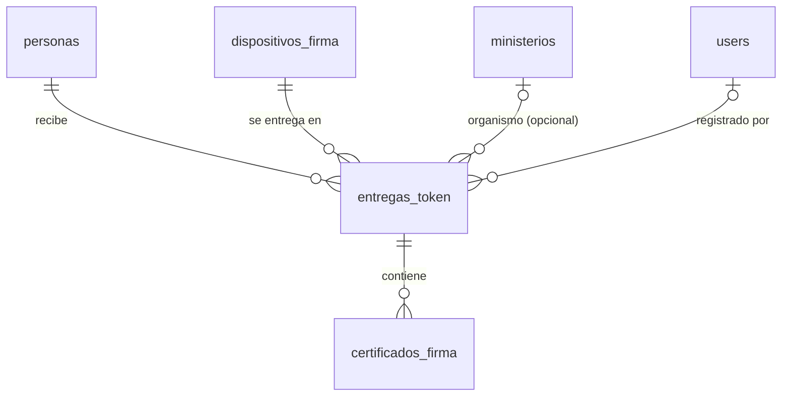

# Propuesta: módulo de dispositivos de firma digital (tokens)

Estado: **implementado** el 2026-10-23 en la rama `feat/firma-digital` (ver `docs/agents/current-state.md`).
Diferencias respecto de este documento, por decisiones de implementación:

- estado adicional `ENVIANDO` para el reclamo atómico;
- email alternativo como respaldo del principal (D-25);
- sin pestaña propia de stock de dispositivos (la API existe);
- sin acta adjunta.

Estado anterior: Opciones elegidas por el responsable:
D-19 a D-22 en `docs/decisions.md`, que coinciden con lo recomendado en este documento. Quedan abiertas
las preguntas del punto 9. Pedido original: entrega de tokens a personas (con o sin organismo del ERP), vigencia del
certificado y recordatorios automáticos por correo antes del vencimiento.

## 1. Qué hay hoy en el ERP (análisis)

| Necesidad | Existe | Detalle |
| :--- | :--- | :--- |
| Personas | sí, `personas` | `cuil_cuit`, `email_principal` y `telefono_principal` son **obligatorios**, y `cuil_cuit` y `email_principal` además son **únicos** (base y validación). No hay tipo ni número de documento. La relación con el organismo es **indirecta** (persona → `asignaciones_rol` → `areas_ti` → `ministerios`) |
| Organismos | sí, `ministerios` (y `areas_ti`, que son unidades TI dentro de un ministerio) | no hay organismos externos |
| Usuarios | `users`, con `persona_id` opcional | no hace falta tocarlos: un titular de token no necesita ser usuario |
| Correo electrónico | **no** | no hay `config/mail.php`, Mailables, vistas (no existe `backend/resources/`) ni `MAIL_*`. Laravel usa por defecto `MAIL_MAILER=log` (escribe en `laravel.log`) |
| Tareas programadas | **no** | `routes/console.php` solo tiene `inspire`; ningún contenedor ejecuta `schedule:work` ni cron |
| Colas | no | no hacen falta: el envío puede ser sincrónico dentro del comando |
| Auditoría | sí, `AuditService::log` | se reutiliza |
| Adjuntos | sí, `documentos_adjuntos` (polimórfica) | se podría reutilizar para el acta de entrega (opcional) |
| UI reutilizable | `PersonaSearchSelect`, `useApi`, `useToast`/`confirmDialog`, el patrón de páginas con modales y las paletas Tailwind | se reutilizan |

## 2. Modelo de datos propuesto

Los cuatro conceptos del pedido se mantienen separados. Todo el esquema se agrega con **migraciones
nuevas**, sin editar las existentes (D-08).

**`personas`** (reutilizada; una migración `ALTER`):

- `cuil_cuit`, `telefono_principal` y `email_principal` pasan a ser **opcionales** (`nullable`). En
  PostgreSQL, un índice `unique` admite varios `NULL`.
- Columnas nuevas: `tipo_documento` (DNI, PASAPORTE, CI, LC, LE, OTRO) y `numero_documento`, ambas
  opcionales, con índice único sobre el par.
- Sin vínculo directo con un organismo: el organismo se registra en cada entrega (ver más abajo).

**`dispositivos_firma`** (token físico):

| Columna | Detalle |
| :--- | :--- |
| `tipo_dispositivo` | p. ej. TOKEN_USB, TARJETA |
| `marca`, `modelo` | — |
| `numero_serie` | opcional; único cuando existe |
| `estado` | DISPONIBLE, ASIGNADO, DEVUELTO, EXTRAVIADO, DADO_DE_BAJA |
| `observaciones` | — |

Más timestamps y soft delete.

**`entregas_token`** (asignación; es el historial):

| Columna | Detalle |
| :--- | :--- |
| `persona_id` | FK restrict |
| `dispositivo_firma_id` | FK restrict |
| `ministerio_id` | **nullable**, FK `nullOnDelete` |
| `organismo_externo` | texto libre opcional, para personas sin organismo del ERP (p. ej. un hospital privado) |
| `cargo_funcion` | texto opcional (p. ej. «Autoridad de Registro») |
| `fecha_entrega`, `fecha_fin` | `fecha_fin` es nullable |
| `estado` | ASIGNADA, DEVUELTA, REEMPLAZADA, EXTRAVIADA, REVOCADA |
| `motivo_fin`, `observaciones` | — |
| `registrado_por_user_id` | — |

Más soft delete.

- Guardar el organismo en la entrega conserva la situación al momento de entregar, aunque la persona
  cambie de organismo después, y no duplica datos de los ministerios.
- Regla: un dispositivo tiene como máximo **una** entrega ASIGNADA. Se garantiza con un índice parcial
  de PostgreSQL (`WHERE estado = 'ASIGNADA' AND deleted_at IS NULL`).

**`certificados_firma`** (vigencia; varios por entrega, para renovar sin cambiar el token):

| Columna | Detalle |
| :--- | :--- |
| `entrega_token_id` | FK cascade |
| `fecha_inicio` | por defecto = `fecha_entrega`; ya distingue la entrega física del inicio del certificado |
| `fecha_vencimiento` | calculada como inicio + 12 meses |
| `vencimiento_manual` | booleano |
| `fecha_recordatorio` | calculada como vencimiento − 30 días |
| `recordatorio_manual` | booleano |
| `recordatorio_estado` | PENDIENTE, ENVIADO, ERROR, SIN_EMAIL, CANCELADO |
| `recordatorio_enviado_at`, `recordatorio_email` | — |
| `recordatorio_intentos`, `recordatorio_ultimo_error` | — |
| `observaciones` | — |

- Estado del certificado: **calculado**, no almacenado, igual que `estado_vigencia` de las asignaciones:
  - VIGENTE;
  - PROXIMO_A_VENCER (vence dentro de la anticipación configurada);
  - VENCIDO;
  - NO_VIGENTE (hay un certificado posterior o la entrega ya no está ASIGNADA).
- Se define **en un solo scope** del modelo, para no repetir DEF-04.

## 3. Lógica de negocio

- **Configuración** en `config/firma_digital.php`, desde `.env`:

  | Variable | Uso | Valor por defecto |
  | :--- | :--- | :--- |
  | `FIRMA_VIGENCIA_MESES` | vigencia del certificado | 12 |
  | `FIRMA_RECORDATORIO_DIAS` | anticipación del recordatorio | 30 |
  | `FIRMA_RECORDATORIO_HORA` | hora del envío | 08:00 |
  | `FIRMA_RECORDATORIO_MAX_INTENTOS` | reintentos ante error | 3 |

  Nada queda fijado en el código.
- **`App\Services\FirmaDigitalService`** centraliza los cálculos:
  - recalcula el vencimiento si no es manual y el recordatorio si no es manual;
  - al cambiar el vencimiento, vuelve el recordatorio a PENDIENTE si todavía no se envió.

  Los cambios de configuración afectan solo a los registros nuevos o editados. Un comando opcional,
  `firma-digital:recalcular`, actualiza los pendientes no manuales.
- **Altas en transacción:** dispositivo (nuevo o existente DISPONIBLE), entrega y certificado.
- **Reemplazo:** se cierra la entrega anterior como REEMPLAZADA y se cancela su recordatorio pendiente.
- **Auditoría:** `AuditService::log` en todas las escrituras (módulo `FIRMA_DIGITAL`).

## 4. Recordatorios automáticos

- **Comando** `php artisan firma-digital:enviar-recordatorios {--dry-run}`
  (`app/Console/Commands/`), programado en `routes/console.php` con
  `Schedule::command(...)->dailyAt(config(...))->withoutOverlapping()`.
- **Candidatos:**
  - certificados con recordatorio PENDIENTE, o en ERROR con `intentos` por debajo del máximo;
  - `fecha_recordatorio <= hoy`;
  - entrega ASIGNADA y certificado no reemplazado.
- **Para cada candidato:**
  1. Se valida el email (`filter_var`). Si no hay uno válido, se marca `SIN_EMAIL`, sin error: el proceso
     no se interrumpe.
  2. Se **reclama** el registro con un `UPDATE ... WHERE recordatorio_estado = 'PENDIENTE'` atómico. Así,
     dos ejecuciones no envían dos veces.
  3. Se envía la Mailable `RecordatorioVencimientoCertificado`. La vista Blade usa la denominación
     institucional de `config('app.agency.*')`.
  4. Se registra ENVIADO con fecha y destinatario, o ERROR con el mensaje.
  5. Cada candidato está en su propio `try/catch`, más una entrada de auditoría.
- **Ejecutor del scheduler:** hoy no existe. Se propone un contenedor nuevo, `erp_scheduler`, con la
  misma imagen que `erp_backend` y el comando `php artisan schedule:work`:
  - en `wslc-setup.ps1`, `wslc-down.ps1` y `docker-compose.yml`;
  - en producción: cron `schedule:run` o el mismo contenedor.
- **Correo (D-22):**
  - en desarrollo, un contenedor nuevo **`erp_mailpit`** (imagen `axllent/mailpit`, con una versión
    fija que se elige al implementar), en la misma red `erp_network`;
  - Laravel se configura con `MAIL_MAILER=smtp`, `MAIL_HOST=mailpit`, `MAIL_PORT=1025`, sin
    autenticación ni TLS;
  - Mailpit **captura todo y no reenvía**, así que los datos demo con direcciones `@gmail.com` nunca
    salen de la máquina;
  - buzón web en `http://localhost:8025`, publicado solo en `127.0.0.1`, como el resto de los puertos;
  - se define en `wslc-setup.ps1` (con `--network-alias mailpit`), `wslc-down.ps1` y
    `docker-compose.yml`;
  - los mensajes se pierden al recrear el contenedor; no hace falta un volumen;
  - regla para el entorno de desarrollo: `MAIL_HOST` nunca apunta a un SMTP real. La validación del
    módulo se hace mirando el buzón de Mailpit;
  - en producción: SMTP del organismo. Faltan host, puerto, cuenta, remitente y credenciales.

## 5. API

Todo dentro de `auth:sanctum`, con el patrón existente: lectura para cualquier perfil, escritura para
`perfil:ADMINISTRADOR,EDITOR`, borrado para `perfil:ADMINISTRADOR`. **Sin rutas públicas.**

| Método | Ruta | Perfil |
| :--- | :--- | :--- |
| GET | `/firma-digital/entregas` (filtros abajo; `per_page` con tope de 100; `stats`) | Auth |
| GET | `/firma-digital/entregas/{id}` | Auth |
| POST/PUT | `/firma-digital/entregas[/{id}]` | E |
| POST | `/firma-digital/entregas/{id}/finalizar` (devolución, reemplazo, extravío) | E |
| POST | `/firma-digital/entregas/{id}/certificados` (renovación) | E |
| PUT | `/firma-digital/certificados/{id}` (fechas manuales) | E |
| POST | `/firma-digital/certificados/{id}/reprogramar-recordatorio` | E |
| GET/POST/PUT | `/firma-digital/dispositivos[/{id}]` | Auth / E |
| GET | `/firma-digital/config` (vigencia y anticipación, para la vista previa en la UI) | Auth |
| DELETE | `/firma-digital/entregas/{id}`, `/firma-digital/dispositivos/{id}` | A |

Filtros de `/firma-digital/entregas`:

- `persona_id`, `q` (nombre, documento, serie);
- `ministerio_id`, `sin_organismo`, `organismo_externo`;
- `estado_entrega`, `estado_certificado`, `vencimiento_desde`/`hasta`;
- `recordatorio_estado`.

Las personas se crean y editan con los endpoints existentes `/personas`.

## 6. Interfaz

- **Página nueva** `frontend/pages/firma-digital/index.vue`, con componentes en
  `frontend/components/firma-digital/` (para no repetir páginas de más de 1.000 líneas):
  - tarjetas de resumen: asignados, próximos a vencer, vencidos, recordatorios pendientes, enviados y
    con error;
  - pestañas «Entregas» y «Recordatorios»;
  - filtros del punto 5.
- **Modal de alta:**
  - `PersonaSearchSelect`, con el botón «Registrar persona nueva» (formulario reducido que llama a
    `POST /personas`);
  - organismo del ERP **o** externo **o** ninguno;
  - datos del dispositivo;
  - fechas calculadas visibles y editables (con la marca «manual»).
- **Detalle por persona:** historial de entregas y certificados. También modales de finalizar, renovar y
  reprogramar el recordatorio.
- Se usan `useApi`, `toast.*` y `confirmDialog`, y los permisos con `v-if` cosméticos de siempre.
- **Archivos existentes que se tocan:**
  - `layouts/default.vue`: un ítem de menú;
  - `useToast.ts`: etiquetas de campos nuevos.

## 7. Cambios en archivos existentes (mínimos)

| Archivo | Cambio |
| :--- | :--- |
| `backend/routes/api.php` | bloque nuevo de rutas |
| `backend/routes/console.php` | la programación del comando |
| `backend/app/Models/Persona.php` | `fillable` de documento y relación `entregasToken` |
| `backend/app/Http/Controllers/Api/PersonaController.php` | validación: CUIL, email y teléfono opcionales; tipo y número de documento. **Afecta al padrón** |
| `frontend/pages/personas/index.vue` | formulario: campos opcionales y documento |
| `frontend/layouts/default.vue`, `frontend/composables/useToast.ts` | menú y etiquetas |
| `backend/app/Providers/AppServiceProvider.php` | `morphMap` `entrega_token`, solo si se adjunta el acta de entrega |
| `.env.example`, `docker-compose.yml`, `wslc-setup.ps1`, `wslc-down.ps1` | variables `FIRMA_*`/`MAIL_*` y los contenedores `erp_scheduler` y `erp_mailpit` |
| `docs/*` | API, arquitectura, producto, desarrollo, decisiones |

Archivos nuevos:

- 4 migraciones, 3 modelos y 1–2 controladores;
- `FirmaDigitalService`, el comando, la Mailable y su vista;
- `config/firma_digital.php`;
- la página y sus componentes;
- un seeder demo con datos ficticios;
- los primeros tests: `phpunit.xml` y tests de feature para cálculos, permisos e idempotencia del envío.

## 8. Riesgos

- **DEF-02:** `wslc-setup.ps1` ejecuta `migrate:fresh` y **borraría los datos de tokens**. Hay que
  resolverlo antes de cargar datos reales.
- **Datos personales nuevos** (documento): no exponerlos en logs ni en correos; DEF-10 aplica al índice
  único del documento cuando hay soft delete.
- **Envío a direcciones reales desde desarrollo:** se mitiga con Mailpit, que captura y no reenvía,
  siempre que `MAIL_HOST` siga apuntando a `mailpit`.
- **Relajar los obligatorios de `personas` cambia el padrón:** el exportador ya omite las personas sin
  email, pero las fichas mostrarían campos vacíos.
- **Sin infraestructura previa de correo ni de scheduler:** es el cambio de infraestructura más grande
  del módulo.

## 9. Preguntas abiertas

Además de las que se hicieron en el chat:

1. Vigencia de un año: ¿desde la entrega o desde la emisión del certificado? (El modelo admite las dos.)
2. Si el recordatorio no se envió y el certificado ya venció, ¿se envía un aviso de «vencido» o se
   cancela?
3. ¿Se reintenta ante un error de SMTP? ¿Cuántas veces?
4. ¿Quién da de alta las entregas: EDITOR y ADMINISTRADOR, como el resto? ¿El LECTOR ve los documentos
   de las personas?
5. ¿Se adjunta el acta de entrega (reutilizando `documentos_adjuntos`)?
6. ¿Copia del recordatorio a una casilla institucional?
7. ¿Texto del correo y remitente?
8. Datos SMTP de producción.
